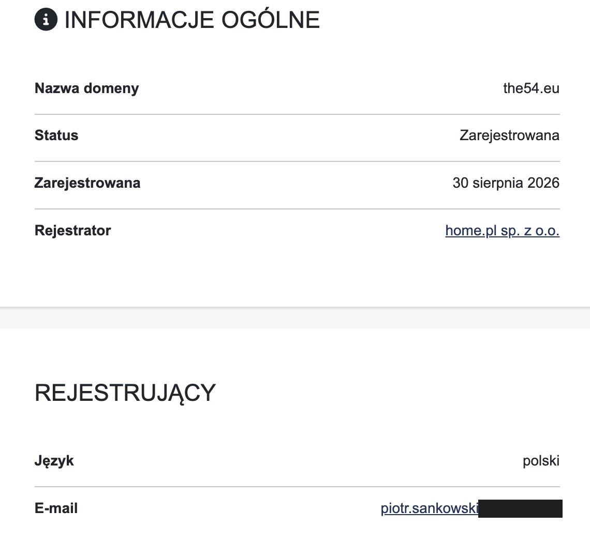

+++
title = "List 54, czyli Lobby AI puka do premiera"
description = "Branża AI w Europie domaga się większego nacisku na międzynarodową rywalizację AI i inwestycji w moce obliczeniowe. Są znaki, że osoby te mają duże wpływy w Polskim rządzie i skutecznie lobbują za swoimi interesami. Panie Premierze, nie chcemy aby firmy AI ryzykowały losem ludzkości!"
+++

Wczoraj autor bloga Trajektorie, Michał Podlewski, [napisał](https://x.com/trajektoriePL/status/2123128101056233511), że za “drastyczny zwrot premiera Tuska w sprawie AI” odpowiada Piotr Sankowski, dyrektor i współzałożyciel firmy MIM SOLUTIONS. Skąd ta teza? Otóż został opublikowany [list otwarty](https://the54.eu) 37 przedstawicieli europejskich firm technologicznych i 22 naukowców do rządów krajów UE o inwestycje mające na celu wygranie w wyścigu AI z USA i Chinami. Wśród polskich sygnatariuszy są Rafał Brzoska, Piotr Sankowski i Mati Staniszewski (prezes ElevenLabs). List nazwany jest w skrócie listem 54.

Punkty z [wpisu](https://www.facebook.com/donaldtusk/posts/pfbid0ZKbGZnmMDASsjg4HJoUbhPy3JtC2M7tu34dsYGjE4mf6jPRSJY2DikDn9QDn1FBGl?locale=pl_PL) premiera Tuska z 13 listopada, który to wpis miał miejsce przed publikacją listu, w zaskakujaco bliski sposób pokrywają się z niektórymi jego tezami:

**Tusk**: Stwórzmy wiodące instytuty badawcze zajmujące się AI

**List**: Musimy utworzyć światowej klasy, flagowe europejskie naukowe i technologiczne instytucje, zajmujące się wyłącznie AI.

**Tusk**: Po drugie, przełóżmy wyniki badań na potencjał przemysłowy

**List**: Instytucje muszą nawiązać ścisłą współpracę z europejskimi firmami technologicznymi, aby wypełnić lukę między badaniami podstawowymi a praktycznym wdrożeniem

**Tusk**: Po trzecie, sprawmy, by reżim 28 działał.

**List**: Potrzebujemy realnego 28 reżimu, dzięki któremu firma będzie mogła zarejestrować się raz i prowadzić działalność w oparciu o jeden zestaw reguł we wszystkich państwach członkowskich

I uwaga… [okazuje się](https://x.com/trajektoriePL/status/2123128101056233511), że domena [https://the54.eu](https://the54.eu), czyli ta na której został opublikowany list, [jest zarejestrowana](https://x.com/trajektoriePL/status/2123128101056233511/photo/4) na e-mail z identyfikatorem piotr.sankowski!

Piotr Sankowski zasiada w rządowej Radzie Przyszłości i to on [przedstawiał](https://www.linkedin.com/posts/piotr-sankowski_a-call-for-control-of-frontier-ai-models-share-7508070326384144384-nrf2/) bardzo negatywne stanowisko wobec apelu 33 krajów o wypracowanie międzynarodowych standardów i czerwonych linii w rozwoju AI. Zachęca do wyścigu AI mimo, że wie, że jesteśmy blisko rekurencyjnego samodoskonalenia tych systemów. Jednocześnie sam zarabia na AI - tzn. jest dyrektorem ds. bezpieczeństwa w firmie, która ma stronie głównej napisane, że dostarcza rozwiązania oparte o AI.

Co martwić powinno ludzi, którzy protestują przeciwko ekspansji centrów danych, jednym z celów sygnatariuszy są inwestycje w moce obliczeniowe i gigafabryki AI. Dogonienie USA pod względem mocy przeznaczonej na AI oznacza 14-krotny wzrost zużycia energii w tym celu i o wiele więcej centrów danych.

Tusk już dziś, czyli już następnego dnia, poinformował, że [odbędzie spotkanie](https://x.com/donaldtusk/status/2123375226872360967) z autorami listu na początku 2027 roku.

Panie premierze, nie chcemy aby firmy AI ryzykowały naszym losem. Zgodnie z [wynikami](https://www.rp.pl/spoleczenstwo/art45246111-sondaz-wyrazna-wiekszosc-polakow-obawia-sie-sztucznej-inteligencji) SW Research 60% Polaków uważa, ze AI stanowi zagrożenie dla ludzkości. Zamiast słuchać lobbystów, niech Pan słucha Polaków!
