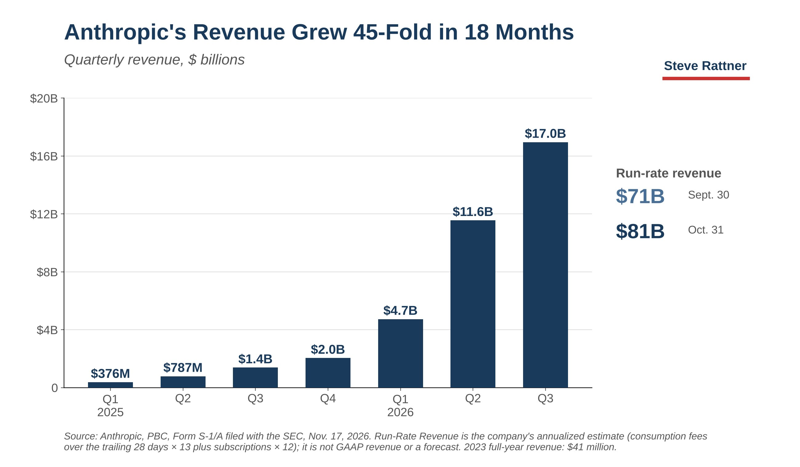

+++
title = "Newsletter Pause AI - Polska: IPO, IPO i po IPO"
description = "Podczas gdy Anthropic zyskuje niewyobrażalne sumy pieniędzy i rozwiązuje największe problemy matematyczne w historii ludzkości, presja biznesowa spotyka się z coraz większym społecznym oporem. Czy będzie go wystarczająco dużo?"
+++

**(od 16.11.2026 r. do 22.11.2026 r.) Podczas gdy Anthropic zyskuje niewyobrażalne sumy pieniędzy i rozwiązuje największe problemy matematyczne w historii ludzkości, presja biznesowa spotyka się z coraz większym społecznym oporem. Czy będzie go wystarczająco dużo?**

Jeszcze niedawno wydawało się, że do przeprowadzenia dowodów matematycznych potrzeba niedostępnej dla algorytmów ludzkiej kreatywności. Pod koniec 2024 roku eksperci średnio [szacowali](https://aiimpacts.org/wp-content/uploads/2026/09/ESPAI2024.pdf), że AI będzie w stanie przeprowadzać dowody matematyczne dopiero w 2050 roku. W tym tygodniu, z pomocą Claude'a, prawdopodobnie rozwiązano kolejny matematyczny problem milenijny w tym roku - hipotezę Riemanna. Zrobił to Levent Alpöge, matematyk i pracownik firmy Anthropic. Hipoteza stanowiła jedną z największych zagadek matematycznych w historii, nad którą głowiono się ponad 160 lat. Polski matematyk, Mateusz Brylski, [podzielił](https://www.youtube.com/watch?v=_gPDWKCzFv8) się w internecie swoją reakcją na wiadomość o odkryciu: 

> Nie mogłem spać po Navierze-Stokesie, a to jest naprawdę spore. (...) Cała nasza cywilizacja ulegnie drastycznej zmianie w ciągu następnych dwóch lat

Stojąca za modelem firma Anthropic w trakcie debiutu giełdowego (19 listopada 2026) [przyciągnęła](https://www.theguardian.com/technology/2026/nov/20/anthropic-ipo-historic-stock-market-debut-key-takeaways-what-next-for-ai) jednego dnia 81 miliardów dolarów, co [było](https://www.theguardian.com/technology/2026/nov/19/anthropic-public-trading-ipo) największą zebraną na giełdzie kwotą w historii. Osoby wewnątrz firmy [mają](https://x.com/SteveRattner/status/2123523070044356875) tyle majątku co łącznie 1/3 Amerykanów. Niektórzy uważają, że zainwestowany kapitał się nie zwróci i to, co obserwujemy, to bańka inwestycyjna. Anthropic [powinien](https://x.com/SteveRattner/status/2123465795816616041) bowiem mieć przychody 17-krotnie większe, aby spłacić swoje zobowiązania odnośnie mocy obliczeniowej i nadal osiągnąć, po uwzględnieniu podatku, 40% marży operacyjnej. Jednak wraz z wykładniczo rosnącymi umiejętnościami AI, wykładniczo [rosną](https://x.com/SteveRattner/status/2123108566865215615/photo/1) także przychody firmy - w ciągu ostatnich 18 miesięcy zwielokrotniły się 45-krotnie:

Przed debiutem pojawiło się bardzo ważne oświadczenie pt. _[MisAnthropic Statement](https://misanthropicstatement.com/)_, podpisane przez ponad tysiąc sygnatariuszy i koordynowane m.in. przez Center for AI Safety (Centrum dla Bezpieczeństwa AI). Oto jego treść:

> Anthropic ostrzega, że samoulepszająca się AI może skoncentrować władzę i wymknąć się spod ludzkiej kontroli, a mimo to pędzi, by zbudować ją jako pierwsza. Firma wykorzystuje wizerunek dbania o bezpieczeństwo, aby przypodobać się inwestorom, pracownikom i opinii publicznej - jednocześnie po cichu rozmiękczając swoje zobowiązania odnośnie bezpieczeństwa i lobbując na rzecz samoregulacji. Anthropic nie jest firmą bezpiecznego AI. Musimy odrzucić jej lekkomyślną próbę gromadzenia władzy w imię większego dobra.

Pod oświadczeniem podpisały się zarówno osoby obawiające się niekontrolowanego rozwoju AI jak i zwolennicy otwartego oprogramowania. Wśród sygnatariuszy znajdziemy m.in współzałożyciela portalu HuggingFace – Thomasa Wolfa, autora najpopularniejszego podręcznika do AI – Stuarta Russella, Maxa Tegmarka (z Future of Life Institute), Nate'a Soaresa (z MIRI), a także dyrektora Open Intelligence Foundation – Matta White'a.

Kolejny tydzień oznaczał też kolejne wspierane przez sztuczną inteligencję ataki hakerskie. Wśród ofiar była firma Autopay S.A. z siedzibą w Sopocie. Ze wstępnych analiz firmy [wynika](https://niebezpiecznik.pl/post/autopay-zhackowany-wykradziono-dane-kart-platniczych-polakow/), że “atak nosił cechy automatyzacji silnie wspieranej przez AI”.

Świadomość, że dalszy rozwój AI może doprowadzić do zagłady rośnie również wśród polityków. Badacz AI Safety Oz Amram [stworzył](https://airiskrecord.org/) mapkę, w której pokazuje, ilu nowo wybranych senatorów w USA uznaje AI za egzystencjalne zagrożenie. Tak jasną deklarację sformułowało 30 z nich, a kolejnych 31 mówiło o poważnych lub katastroficznych ryzykach. W pierwszej trzydziestce jest Chris Van Hollen, główny konkurent Chucka Shumera w partii Demokratycznej na lidera większości w Senacie. Van Hollen zauważył, że “czołowe modele AI już dziś są zagrożeniem dla ludzkości”.

Ważne słowa wygłosił także prezydent USA, Donald Trump. 20 listopada, dzień po spotkaniu z Xi Jinpingiem na szczycie APEC (Wspólnoty Gospodarczej Azji i Pacyfiku), zapowiedział wprowadzenie wspólnych zabezpieczeń odnośnie AI. Sekretarz skarbu Scott Bessent [sprecyzował](https://www.scmp.com/news/china/diplomacy/article/3375321/xi-trump-agree-military-ai-decisions-must-involve-humans-bessent-says), że porozumienie będzie dotyczyło tego, że w decyzjach o charakterze wojskowym zawsze będzie musiał być obecny człowiek. Jest to dobra wiadomość, tym bardziej że jest więcej sygnałów wskazujących na to, że Chiny traktują zagrożenia poważnie.

Matt Sheehan, starszy analityk Fundacji Carnegie na rzecz Pokoju Międzynarodowego, [powiedział](https://www.nytimes.com/2026/09/15/opinion/ezra-klein-podcast-matt-sheehan.html) w wywiadzie dla New York Timesa, że Chińczycy, do tej pory koncentrujący się głównie na rzeczach jak psychologiczny wpływ AI na nieletnich oraz kontrola przestrzeni informacyjnej, zaczynają powoli zauważać egzystencjalne ryzyka związane z najpotężniejszymi modelami – utratę kontroli nad AI oraz możliwość tworzenia zaawansowanej broni chemicznej oraz biologicznej. Temat ten jest opisany obszernie w [tekście](https://www.lesswrong.com/posts/yyz2LAptjWgR7PKBD/trump-on-superintelligence-it-may-be-too-super-what-is-china) badacza AI Jacques Thibodeau na forum LessWrong. Autor omawia, z bardzo dużą liczbą odnośników i cytatów, jak oraz w jakim zakresie w Chinach rośnie świadomość najpoważniejszych ryzyk związanych z AI (może on być potraktowany jako czytelnicza rekomendacja dla odbiorców tego newslettera).

W Polsce także pierwszy raz na wysokim szczeblu pojawiła się deklaracja uznająca istnienie ryzyka egzystencjalnego. Donald Tusk w trakcie szczytu w Dublinie [stwierdził](https://www.gov.pl/web/premier/premier-po-szczycie-w-dublinie-polska-bedzie-odgrywala-kluczowa-role-w-negocjacjach-w-sprawie-ukrainy):

> Naszym celem jest ogólnoświatowa decyzja, która ograniczyłaby rozwój AI do bezpiecznego poziomu, tak jak w przypadku broni jądrowej.

Kilka dni później jednak zdarzyła się niepokojąca rzecz. 18 listopada wystosowany został do rządów wszystkich krajów UE [list](https://the54.eu/) podpisany przez 37 przedstawicieli firm technologicznych. Chcą oni, nie licząc się z ryzykami egzystencjalnymi, aby Unia wspierała i rozwijała najbardziej zaawansowane modele AI i wygrała w wyścigu z Chinami i USA. Premier Donald Tusk odpowiedział na list już następnego dnia i zapowiedział zorganizowanie specjalnego szczytu na początku 2027 roku. Tak szybka reakcja premiera źle wróży (warto przeczytać [nasz krótki tekst](https://pauseai.pl/opinie/list-54-czyli-lobby-ai-puka-do-premiera/) o tym). Autorzy listu domagają się też, aby UE dogoniła USA pod względem mocy obliczeniowej. Problem polega na tym, że moce, które USA pompują w obliczenia komputerowe, są 14 razy większe niż unijne. Dogonienie USA pod tym względem będzie wiązało się z niewyobrażalną ekspansją centrów danych a także wzrostem emisji gazów cieplarnianych. 19 listopada Międzynarodowa Agencja Energetyczna [opublikowała](https://oko.press/na-zywo/na-zywo-relacja/ai-napedza-kryzys-klimatyczny-emisje-centrow-danych-wzrosna-o-70-proc-do-2030-roku) raport, z którego wynika, że emisje CO2 związane z wytwarzaniem energii elektrycznej dla serwerowni wzrosną do 2030 roku o 70%. Trzy czwarte tego wzrostu to efekt inwestycji w AI.

Bez presji społecznej politycy ugną się przed żądaniami biznesu dążącego do rozwoju AI. Wiedzą o tym mieszkańcy Londynu. 21 listopada Pause AI organizowało protest w samym jego centrum. Ponad tysiąc osób domagało się przerwy w trenowaniu najpotężniejszych modeli i manifestowało, że nie pozwoli na to by AI ich zabiło. „Tak. Boję się o swoje życie, swoich przyjaciół i swoją rodzinę. Ale wtedy spoglądam na was. Dziękuję wam, że pojawiliście się i przemówiliście. Dziękuję wam piękni ludzie.” – [podsumował](https://x.com/FournesMaxime/status/2124144436946915744) przed zgromadzonymi Maxime Fournes, prezes Pause AI.
